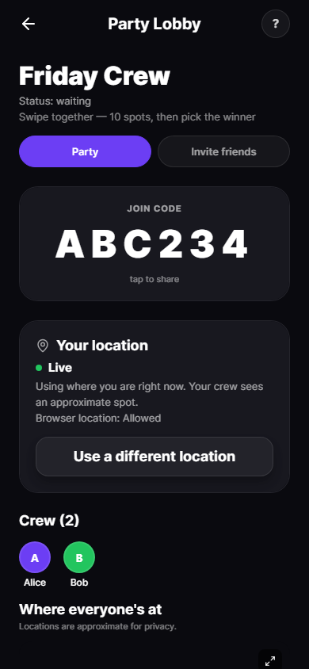
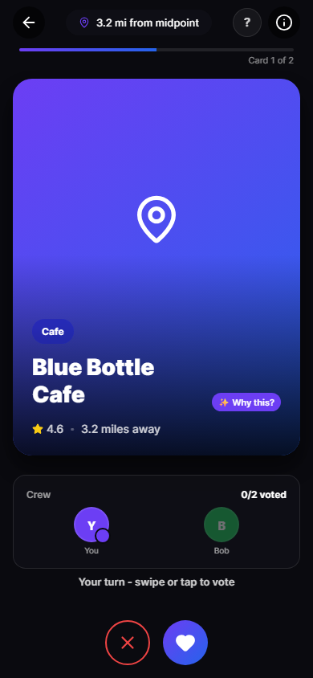
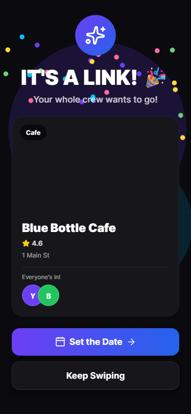
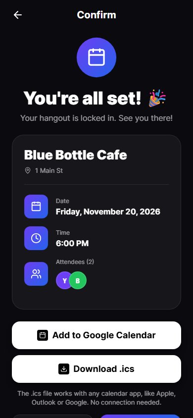
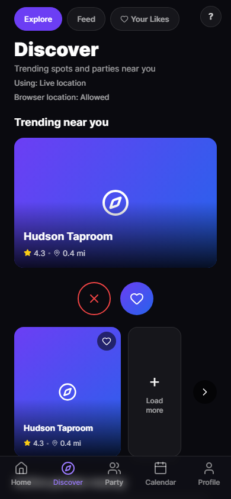
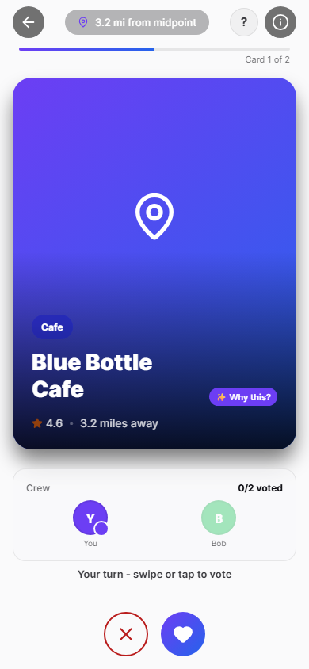
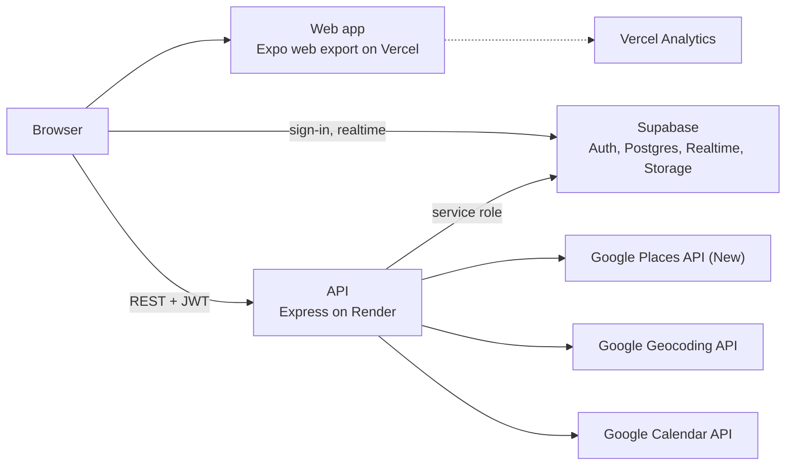

# LinkdUp

Group meetups without the group chat: everyone shares a location, the group swipes on nearby spots, votes on a place, and locks in a date.

**Live:** [https://linkdup.app](https://linkdup.app)

**Try the demo:** open the site and press **Try the demo** on the Login screen. No sign-up. The demo account is read-only.

## Screenshots

| Party lobby | Swipe | Link |
|---|---|---|
|  |  |  |

| Calendar confirmation | Discover | Swipe (light) |
|---|---|---|
|  |  |  |

## Features

- Parties with a 6-character join code and a live crew list
- Live location or a chosen city, with fuzzed coordinates so nobody's exact location is shared
- Venues near the group midpoint from Google Places
- Locked-step swiping: everyone votes on the same card before the deck moves on
- Date proposals and voting, with the host locking the final date
- Add to Google Calendar, or download an .ics file for any calendar app
- Discover tab, social feed with photos, likes and comments, friends, saved collections, blocking
- Dark and light themes
- Read-only demo account

## How it works

1. **Create a party.** The host creates a party and shares the join code. Friends join from Home.
2. **Share locations.** Each member uses live location or picks a city. The server fuzzes each point and computes the midpoint.
3. **Swipe.** The host starts swiping. Everyone votes on the same venue card, and the deck advances when all members have voted.
4. **Get a Link.** At the end of the round the top venue is proposed. When the group accepts it, the party gets a Link (the match).
5. **Lock a date.** Members propose and vote on dates, the host locks one, and everyone can add it to Google Calendar or download an .ics file.

## Architecture



The web app talks to Supabase directly for sign-in, realtime subscriptions and public avatar and post images. All other reads and writes go through the API.

Key decisions:

- **Photo proxy.** Venue photos load through `GET /api/photo`, so the Google Maps key stays on the server and never reaches the browser. The proxy validates the photo name, rate limits each IP, and caches bytes in memory.
- **Row level security with a service-role API.** RLS is on for every app table, open and unused policies were dropped, and realtime tables allow members-only reads. The API uses the service role and checks party membership and host ownership itself.
- **Locked-step voting.** The party tracks the current card and voting round, so all members see the same card and advance together. A proposal step turns the top venue into a Link.
- **Location privacy.** Coordinates are fuzzed with an offset keyed on a server secret, distances are rounded, and the midpoint is computed from fuzzed points.
- **Google cost limits.** Daily quotas are set on each Google API, and quota errors become a friendly "venue limit reached" message. Nearby searches are cached in memory for 15 minutes and photos for 1 hour. Geocoded cities are cached for 24 hours in a server-only table.
- **Read-only demo.** One shared demo account. The server refuses its writes with `403 demo_read_only`, serves Discover and swipe cards from stored rows so it spends no Google quota, and hides demo users from everyone else.

## Tech stack

| Layer | Tech |
|---|---|
| Web app | Expo SDK 54, React Native 0.81 with React Native Web, React 19, TypeScript, React Navigation, Reanimated, Leaflet |
| API | Node.js 22, Express 4, TypeScript, zod, helmet |
| Data | Supabase: Postgres, Auth (email/password and Google), Realtime, Storage |
| Google | Places API (New), Geocoding API, Calendar API v3 |
| Hosting | Vercel (web), Render (API) |
| Testing | `node:test` (server and mobile logic), Jest with jest-expo and Testing Library (screens), Playwright (screenshots) |
| CI | GitHub Actions |

## Repo layout

```
linkdup/
├── .github/workflows/ci.yml   CI for server and mobile
├── diagrams/                  ERD, architecture, FDD, WBS, Gantt (SVG)
├── docs/                      Deployment, setup, test plan, checklists, known issues
├── mobile/
│   ├── src/                   Screens, components, navigation, services, theme
│   ├── test/                  Logic tests (node:test)
│   ├── screens-test/          Screen tests (Jest)
│   ├── shots/                 Playwright screenshot script
│   └── public/                Static web assets and demo images
├── server/
│   ├── src/                   Routes, services, middleware
│   ├── src/db/                Schema, migrations, demo seed
│   └── test/                  API tests (node:test)
└── render.yaml                Render blueprint for the API
```

## Quality

Latest local runs on this branch:

| Suite | Command | Result |
|---|---|---|
| Server | `cd server && npm test` | 254 passed, 0 failed |
| Mobile logic | `cd mobile && npm run test:logic` | 193 passed, 0 failed |
| Mobile screens | `cd mobile && npm run test:screens` | 78 passed, 0 failed |

CI runs on every pull request and every push to `main`. For both the server and the mobile app it runs typecheck, tests with coverage (posted to the job summary), and a build.

Security fixes made during the project:

- Locked down RLS: dropped open and unused policies, members-only reads for realtime tables
- Membership and host checks on votes, match, date and calendar routes
- Signed, expiring OAuth state for Google Calendar
- Removed the Maps key from stored photo URLs and moved photos behind the server proxy
- Location fuzzing keyed on a server secret, with rounded distances
- Per-IP rate limits on auth, join, school lookup, username check, photos and demo sign-in
- Whitelisted friend search characters and rejected non-UUID ids
- Image-only upload extensions
- Internal error messages hidden from 500 responses
- `CORS_ORIGIN` required in production
- Input validation and write caps before any Google or cache call

## Run locally

Prerequisites: Node.js 22, a Supabase project, and a Google Cloud project with Places API (New), Geocoding API and Calendar API enabled. Setup details are in [docs/SETUP_GUIDE.md](docs/SETUP_GUIDE.md), and hosting is in [docs/DEPLOYMENT.md](docs/DEPLOYMENT.md).

1. Apply `server/src/db/schema.sql` and the files in `server/src/db/migrations/` in the Supabase SQL editor.
2. Start the API:

   ```bash
   cd server
   cp .env.example .env
   npm install
   npm run dev        # http://localhost:3000
   ```

   Fill in `.env`:
   - Required: `SUPABASE_URL`, `SUPABASE_ANON_KEY`, `SUPABASE_SERVICE_ROLE_KEY`, `GOOGLE_MAPS_API_KEY`, `GOOGLE_OAUTH_CLIENT_ID`, `GOOGLE_OAUTH_CLIENT_SECRET`, `GOOGLE_OAUTH_REDIRECT_URI`
   - Optional: `PORT`, `NODE_ENV`, `CORS_ORIGIN` (required when `NODE_ENV` is `production`), `ENABLE_GEMINI_PITCHES`, `GEMINI_API_KEY`
   - Demo mode, off unless all three are set: `DEMO_USER_ID`, `DEMO_USER_EMAIL`, `DEMO_USER_PASSWORD`

3. Start the web app in another terminal:

   ```bash
   cd mobile
   cp .env.example .env
   npm install --legacy-peer-deps
   npx expo start --web
   ```

   Fill in `.env`: `EXPO_PUBLIC_API_URL`, `EXPO_PUBLIC_SUPABASE_URL`, `EXPO_PUBLIC_SUPABASE_ANON_KEY`.

4. Run the tests with `npm test` in `server` and in `mobile`.

## Credits and context

Built by a five-person team for the NJIT CS/IT 491 capstone (Spring 2026, 2nd place). Israel Alcantara was the backend engineer. Luis Duarte led the team and managed the project. Yash Amin, Joshua Hernandez and Nekhi Glover helped test and debug before the showcase and produced the midterm video.

The app is built and tested on the web. Vercel Analytics is enabled on the web app for page views. Open issues are listed in [docs/KNOWN_ISSUES.md](docs/KNOWN_ISSUES.md).

Coursework. Not for redistribution.
